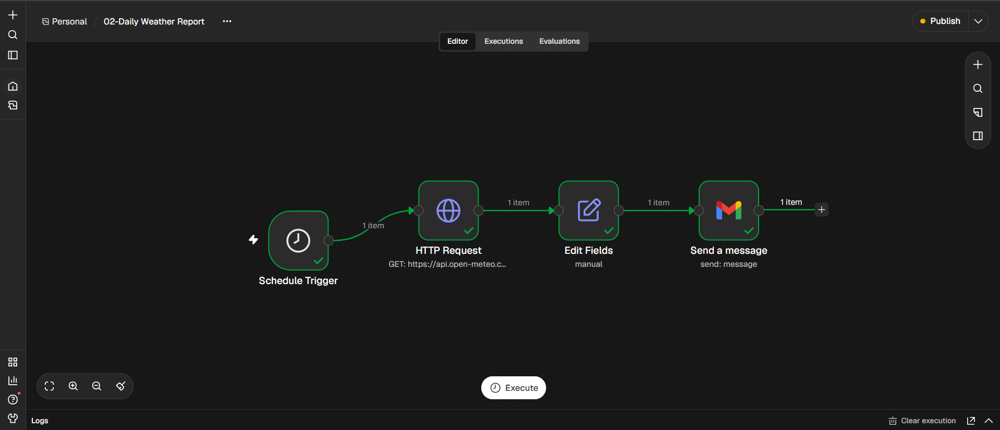

# \# Daily Weather Report Automation


# An automated daily weather reporting workflow built using \*\*n8n\*\*, \*\*Open-Meteo API\*\*, and \*\*Gmail\*\*.


# \## Overview

## Workflow Overview

The following screenshot shows the complete n8n automation workflow.




# This workflow retrieves daily weather information for Cuddalore, Tamil Nadu, processes the weather data, and sends a formatted email report automatically.


# \## Workflow Architecture


# Schedule Trigger → HTTP Request → Edit Fields → Gmail


# \## Technologies Used


# \- \*\*n8n:\*\* Workflow automation

# \- \*\*Open-Meteo API:\*\* Weather data retrieval

# \- \*\*Gmail:\*\* Automated email delivery

# \- \*\*Docker:\*\* Local n8n deployment


# \## Features


# \- Scheduled daily execution at 9:30 AM

# \- Retrieves current temperature, humidity, and wind speed

# \- Retrieves maximum and minimum temperatures

# \- Retrieves daily precipitation probability

# \- Formats weather information into an HTML email

# \- Automated email delivery through Gmail


# \## API


# Weather data provided by \[Open-Meteo](https://open-meteo.com/).


# \## Setup Instructions


# 1\. Install and configure n8n.

# 2\. Import `workflow/daily-weather-report.json`.

# 3\. Configure your Gmail OAuth2 credentials in n8n.

# 4\. Update the recipient email address.

# 5\. Configure the workflow timezone to `Asia/Kolkata`.

# 6\. Activate the workflow.


# \## Project Structure


# ```text

# n8n-weather-automation/

# ├── workflow/

# │   └── daily-weather-report.json

# ├── screenshots/

# └── README.md

# ```


# \## Learning Outcomes


# \- Building scheduled automation workflows

# \- Working with REST APIs and HTTP requests

# \- Processing JSON responses

# \- Mapping data between workflow nodes

# \- Configuring email automation

# \- Managing workflow configurations with Git


# \## Author


# Vijay Prakash


# GitHub: \[@vijayworkflows](https://github.com/vijayworkflows)

